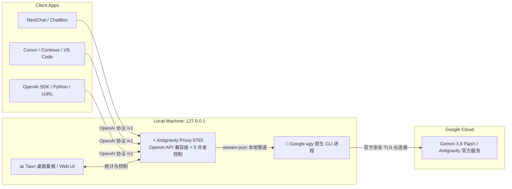

<div align="center">

# ⚡ Antigravity Proxy

**将 Google Antigravity 官方原生 CLI 无缝转换为标准 OpenAI API 的本地代理服务**

[English](README_EN.md) | 简体中文

<br/>

[](LICENSE)
[]()
[]()
[]()
[](CONTRIBUTING.md)

</div>

---

## 📖 简介

**Antigravity Proxy** 是一款轻量、极速、零配置的本地反代工具。它将本机已登录授权的 Google Antigravity 官方命令行（`agy`）转换为标准 **OpenAI Chat Completions API**（`http://127.0.0.1:8765/v1`）。

你可以直接把任何原本支持 OpenAI / ChatGPT 的客户端（例如 **NextChat**、**ChatBox**、**Cursor**、**Continue**、**Cherry Studio**、**Open WebUI**、**Claude Dev** 以及官方 `openai-python` SDK），直接无缝接入本地 Antigravity 官方原生引擎，享受极速生成与庞大上下文！

---

## ✨ 核心亮点

* 🛡️ **0 封号风险（纯本地原生回路）**
  * 区别于传统在公网 VPS 搭建、伪造浏览器指纹、多人共享 IP 的高危反代池；
  * 本项目服务严格绑定在 `127.0.0.1`，仅在本机直接拉起官方原生 `agy` 进程并调用官方接口；
  * 数据包、TLS 指纹和授权完全走官方原装通信协议，无 IP 漂移，享受官方原生免风控待遇。

* ⚡ **真流式 SSE 逐字打字机 (`stream: true`)**
  * 原生兼容 OpenAI `text/event-stream` 格式，打字机首字毫秒级推送，流畅自然。

* 🚦 **5 路安全并发与平滑队列**
  * 内置 `BoundedSemaphore(5)` 控制机制，单机支持 5 路并行并发；
  * 突发并发请求自动在本地内存安全队列中排队，彻底杜绝瞬间超频触发 Google 429 报错。

* 📊 **6 联专业级实时监控看板 (Apple 风格)**
  * 自带轻量优美的桌面 Web 仪表盘，支持实时刷新：
    * 📥 **输入 Token 总数 (Prompt)**
    * 📤 **输出 Token 总数 (Completion)**
    * 🪙 **累计消耗 Token 总量 (Total)**
    * 📊 **调用总次数 / 成功率**
    * ⚡ **平均生成速率 (TPS，实测峰值达 190+ tokens/s)**
    * ⏱️ **平均响应延迟**
  * 包含最近 50 条调用流水明细表格（耗时、输入/输出用量、速率、状态一览无余）。

* 🔄 **智能模型别名自动路由**
  * 请求传入 `gpt-4o`、`claude-3-5-sonnet`、`o1`、`deepseek-v3` 等别名时，自动无损路由映射到极速版 `gemini-3.8-flash`，无需逐个客户端修改模型名称。

* 🖥️ **跨平台双端原生支持**
  * **macOS**：提供 DMG 安装包及 `.app` 原生桌面程序，自带菜单栏控制；
  * **Windows**：提供一键批处理脚本（`start.bat` / `start.ps1`）与 NSIS 安装包。

---

## 🏗️ 架构原理



---

## 🚀 快速开始

### 前提条件
1. 本机已安装并授权官方 **Antigravity CLI**（即在终端运行 `agy --version` 或任意提问正常）。
2. 本机具备 **Python 3.10+** 环境。

### 方式一：使用一键脚本启动（最轻量无依赖）

#### macOS / Linux:
```bash
# 克隆仓库
git clone https://github.com/xqingting/antigravity-proxy.git
cd antigravity-proxy

# 一键启动服务 (后台常驻)
./start.sh

# 查看健康状态
./status.sh

# 停止服务
./stop.sh
```

#### Windows (CMD 或 PowerShell):
```bat
:: 双击或在 CMD 中运行：
start.bat

:: 查看状态：
status.bat

:: 停止服务：
stop.bat
```
*(Windows PowerShell 用户可直接使用 `.\start.ps1` 与 `.\stop.ps1`)*

---

### 方式二：使用原生桌面客户端（带仪表盘看板）

前往 [Releases](https://github.com/xqingting/antigravity-proxy/releases) 页面下载对应安装包：
- **macOS**：下载 `Antigravity Proxy_1.0.0_aarch64.dmg`（或 Intel 架构安装包），拖入 Applications 即可使用。
- **Windows**：下载 `Antigravity.Proxy_1.0.0_x64-setup.exe` 安装。

运行后，界面将提供：
- 启停/重启服务控制按钮
- 6 联 Token 与调用性能看板
- 真流式打字机连通性测试区
- 最近调用记录与实时运行日志

---

## 🔌 客户端配置指南

启动代理后，在任何支持 OpenAI 格式的软件中填入：

| 配置项 | 填写内容 |
| :--- | :--- |
| **API Base URL (接口地址)** | `http://127.0.0.1:8765/v1` |
| **API Key (密钥)** | 任意填写（如 `sk-antigravity-local`，本地不强制校验） |
| **Model (模型名称)** | `gemini-3.8-flash` *(或直接填 `gpt-4o`、`claude-3-5-sonnet`，系统自动映射)* |

### 常见客户端对接演示

#### 1. NextChat (ChatGPT-Next-Web)
* 设置 -> 模型服务商选择 `OpenAI`；
* 接口地址填：`http://127.0.0.1:8765`；
* API Key 填：`sk-antigravity-local`；
* 自定义模型增加：`gemini-3.8-flash`。

#### 2. ChatBox
* 设置 -> 模型提供方选择 `OpenAI API`；
* API 域名：`http://127.0.0.1:8765`；
* API 密钥：`sk-antigravity-local`；
* 模型：`gemini-3.8-flash`。

#### 3. Cursor / Continue (VS Code)
* 在 Continue `config.json` 中配置：
  ```json
  {
    "models": [
      {
        "title": "Antigravity Flash",
        "provider": "openai",
        "model": "gemini-3.8-flash",
        "apiBase": "http://127.0.0.1:8765/v1",
        "apiKey": "sk-antigravity-local"
      }
    ]
  }
  ```

#### 4. Python SDK 原生调用
```python
from openai import OpenAI

client = OpenAI(
    base_url="http://127.0.0.1:8765/v1",
    api_key="sk-antigravity-local",
)

response = client.chat.completions.create(
    model="gemini-3.8-flash",
    messages=[{"role": "user", "content": "用一句话介绍你自己"}],
    stream=True,
)

for chunk in response:
    if chunk.choices[0].delta.content:
        print(chunk.choices[0].delta.content, end="", flush=True)
print()
```

#### 5. cURL 终端测试
```bash
curl http://127.0.0.1:8765/v1/chat/completions \
  -H "Content-Type: application/json" \
  -d '{
    "model": "gemini-3.8-flash",
    "messages": [{"role": "user", "content": "你好，写一首关于秋天的打油诗"}],
    "stream": true
  }'
```

---

## ❓ 常见问题 (FAQ)

### Q: 这个项目会像第三方反代那样容易被 Google 封号吗？
**A: 完全不会。**
传统的第三方反代通常部署在海外公网 VPS，伪造浏览器指纹，且一个 IP 代理成百上千个账号，极易触发 Google Cloud 账号安全风控。  
而 **Antigravity Proxy** 只是一个**本地端口转换器**：
1. 请求完全发生在本机 `127.0.0.1` 回环网络，不经过任何不受信的第三方中转服务器；
2. 每一个请求都直接唤醒你本地电脑上官方正版编译的 `agy` 官方 CLI 工具；
3. 通信指纹、身份鉴权与握手证书 100% 属于 Google 官方原装程序，对 Google 服务端而言，这就是你在本机终端里敲了一条命令行，属于官方认可的原生开发者调用。

### Q: 默认模型与思考强度是什么？
默认主干模型为 `gemini-3.8-flash`，思考级别为 `high`（高精度推理）。可通过命令行参数自定义：
```bash
python3 agy_proxy.py --port 8765 --model gemini-3.8-flash --effort medium --max-concurrency 5
```

---

## 📄 开源协议

本项目基于 [MIT License](LICENSE) 开源发布。你可以自由使用、修改与分发。
