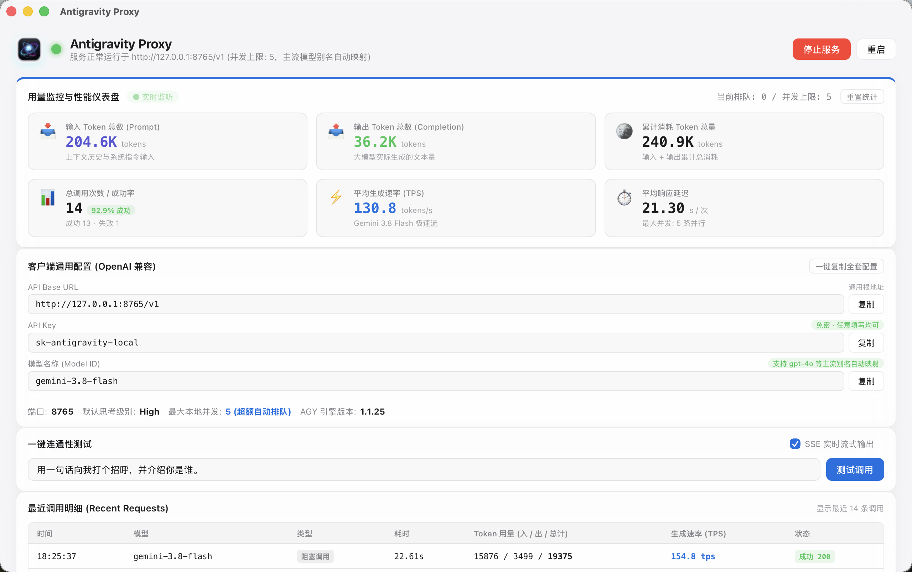

<div align="center">

# ⚡ Antigravity Proxy

**Local OpenAI-Compatible API Proxy Bridge for the Official Google Antigravity CLI (`agy`)**

English | [简体中文](README.md)

<br/>

[](LICENSE)
[]()
[]()
[]()
[](CONTRIBUTING.md)

</div>

---

<div align="center">
  
  <p><i>Antigravity Proxy Modern 6-Card Dashboard & Client Configuration Center</i></p>
</div>

---

## 📖 Overview

**Antigravity Proxy** is a lightweight, zero-configuration local API gateway that transforms your authenticated Google Antigravity CLI (`agy`) into a standard **OpenAI-compatible Chat Completions API** (`http://127.0.0.1:8765/v1`).

With Antigravity Proxy, you can connect any software built for OpenAI (e.g., **NextChat**, **ChatBox**, **Cursor**, **Continue.dev**, **Cherry Studio**, **Open WebUI**, official `openai` SDKs) directly to the native Google Antigravity reasoning engine with zero risk of account ban.

---

## ✨ Key Features

* 🛡️ **Zero-Ban Risk (Local Loopback Design)**
  * Unlike public cloud proxies with spoofed browser fingerprints and shared IPs that trigger account suspensions,
  * This proxy strictly binds to `127.0.0.1` and executes the official local `agy` binary directly on your machine.
  * All handshakes and TLS sessions originate from Google's official CLI without IP jitter or abnormal fingerprints.

* ⚡ **True SSE Streaming (`stream: true`)**
  * Fully compliant with OpenAI `text/event-stream` SSE specs.
  * Millisecond first-token latency with real-time typewriter output.

* 🚦 **5-Way Concurrency with Smooth In-Memory Queue**
  * Supports up to 5 concurrent requests in parallel via `BoundedSemaphore(5)`.
  * Extra incoming requests smoothly queue locally, preventing Google 429 rate-limit errors.

* 📊 **6-Card Apple-Style Monitoring Dashboard**
  * Built-in desktop UI featuring:
    * 📥 **Input Token Count (Prompt)**
    * 📤 **Output Token Count (Completion)**
    * 🪙 **Total Token Usage**
    * 📊 **Total Requests & Success Rate**
    * ⚡ **Average Token Generation Speed (TPS, up to 190+ tokens/s)**
    * ⏱️ **Average Latency**
  * Detailed history table with the latest 50 requests.

* 🔄 **Intelligent Model Alias Routing**
  * Requests asking for `gpt-4o`, `claude-3-5-sonnet`, `o1`, or `deepseek-v3` automatically map to `gemini-3.8-flash` without reconfiguring client settings.

* 🖥️ **Cross-Platform Support**
  * **macOS**: Native DMG installer and `.app` bundle (Apple Silicon & Intel).
  * **Windows**: One-click scripts (`start.bat` / `start.ps1`) and NSIS installer.

---

## 🚀 Quick Start

### Prerequisites
1. Installed and authenticated official **Antigravity CLI** (`agy`).
2. **Python 3.10+** installed.

### Option 1: One-Click Script (Headless / Lightweight)

#### macOS / Linux:
```bash
git clone https://github.com/xqingting/antigravity-proxy.git
cd antigravity-proxy

# Start service in background
./start.sh

# Check status
./status.sh

# Stop service
./stop.sh
```

#### Windows (Command Prompt or PowerShell):
```bat
start.bat
status.bat
stop.bat
```
*(PowerShell users: run `.\start.ps1` and `.\stop.ps1`)*

---

### Option 2: Native Desktop App (GUI with Live Metrics)

Download pre-built binaries from the [Releases](https://github.com/xqingting/antigravity-proxy/releases) page:
* **macOS**: `Antigravity Proxy_1.0.0_aarch64.dmg`
* **Windows**: `Antigravity.Proxy_1.0.0_x64-setup.exe`

---

### Option 3: Use as an Official Antigravity Agent Skill 🤖

If you use Google Antigravity IDE or the `agy` CLI assistant, you can install Antigravity Proxy directly as a **standardized Agent Skill**:

```bash
# Global installation (recommended for all workspaces)
mkdir -p ~/.gemini/config/skills
git clone https://github.com/xqingting/skill-antigravity-proxy.git ~/.gemini/config/skills/antigravity-proxy
```

* Dedicated Skill Repository: [**https://github.com/xqingting/skill-antigravity-proxy**](https://github.com/xqingting/skill-antigravity-proxy)

---

## 🔌 Client Configuration

Point your AI applications to:

| Field | Value |
| :--- | :--- |
| **API Base URL** | `http://127.0.0.1:8765/v1` |
| **API Key** | Any string (e.g. `sk-antigravity-local`) |
| **Model** | `gemini-3.8-flash` *(or `gpt-4o` / `claude-3-5-sonnet`)* |

### Example: Python OpenAI SDK
```python
from openai import OpenAI

client = OpenAI(
    base_url="http://127.0.0.1:8765/v1",
    api_key="sk-antigravity-local",
)

response = client.chat.completions.create(
    model="gemini-3.8-flash",
    messages=[{"role": "user", "content": "Explain quantum computing in one sentence."}],
    stream=True,
)

for chunk in response:
    if chunk.choices[0].delta.content:
        print(chunk.choices[0].delta.content, end="", flush=True)
print()
```

---

## 📄 License

Released under the [MIT License](LICENSE).
